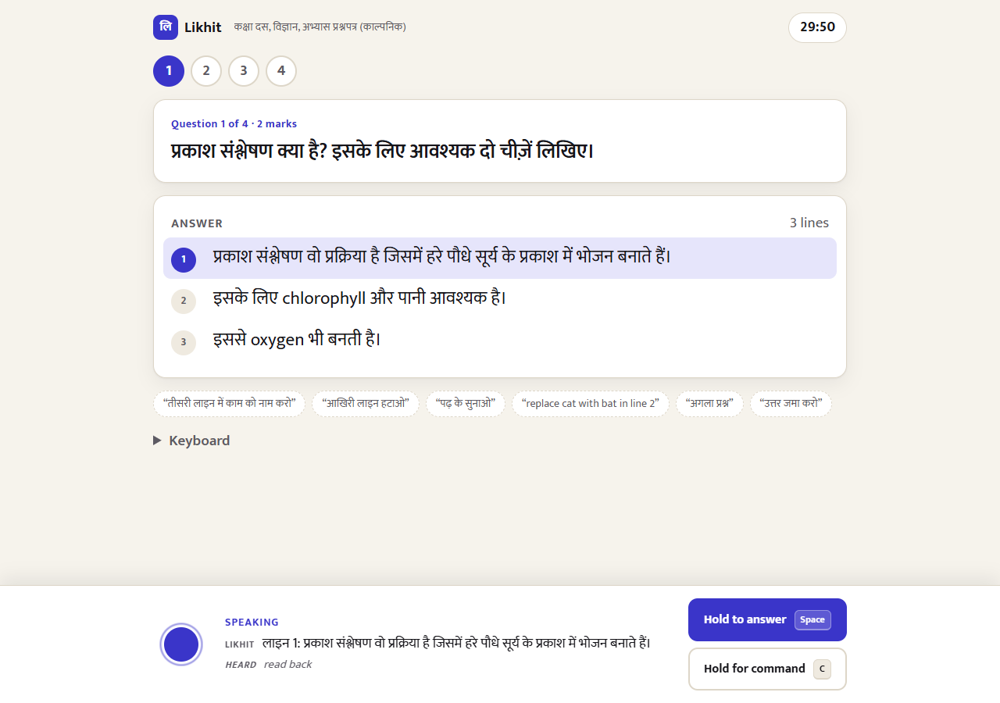
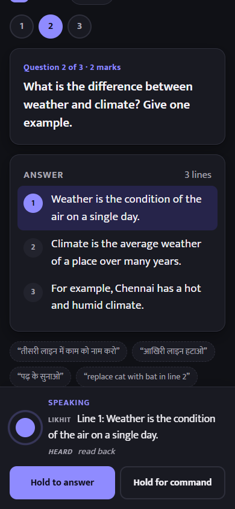

# Likhit (लिखित)

**A voice exam scribe for visually impaired students.** Likhit reads each question aloud in the student's language. The
student dictates the answer (Hindi, English or Hinglish) and edits it by voice: "तीसरी लाइन में काम को नाम करो",
"आखिरी लाइन हटाओ", "पढ़ के सुनाओ". Every change goes into a hash-chained audit log that an invigilator can verify.

Built on Gnani AI for the **Great Indian AI Internship Challenge 2026**: Prisma v3.0 for speech to text,
Timbre v3.0 for text to speech. All papers and audio are synthetic. See [PLAN.md](PLAN.md) for the design and
roadmap.

> Status: working prototype (Oct 30, 2026). The end-to-end loop runs against the real Gnani APIs.

| Reading the answer back: the current line is highlighted and captioned | Phone, dark mode |
|---|---|
|  |  |

## Run

```bash
python -m venv .venv
.venv/Scripts/pip install -r requirements.txt   # Windows; use .venv/bin/pip on macOS/Linux
cp .env.example .env                              # add your Gnani key
.venv/Scripts/python -m uvicorn likhit.server:app --port 8000
```

Open http://localhost:8000 in Chrome or Edge. The invigilator picks a paper and presses **Start**. From then on,
everything is done by keyboard and voice:

| Key | Action |
|---|---|
| **Space** (hold) | Dictate the answer |
| **C** (hold) | Speak a command |
| R / Q | Read the answer / repeat the question |
| N / P | Next / previous question |
| U / T / H | Undo / time left / help |
| + / − / Esc | Faster / slower / stop speaking |

The answer sheet is at `/export/<session>`. Print it to PDF from the browser. To verify a log:
`python -m likhit.verify <session>`.

## Tests

```bash
.venv/Scripts/python -m pytest -q
```

## Layout

| Path | What |
|---|---|
| `likhit/gnani.py` | Prisma and Timbre client (serialised calls, 429 retry, TTS disk cache) |
| `likhit/commands.py` | Deterministic Hindi/English/Hinglish command parser |
| `likhit/answer.py` | Numbered answer lines, voice edits, undo |
| `likhit/session.py` | Exam session plus hash-chained audit log |
| `likhit/scribe.py` | Applies commands and chooses what to say back |
| `static/` | Eyes-free browser UI: AudioWorklet → 16 kHz WAV, earcons, speech queue with barge-in |
